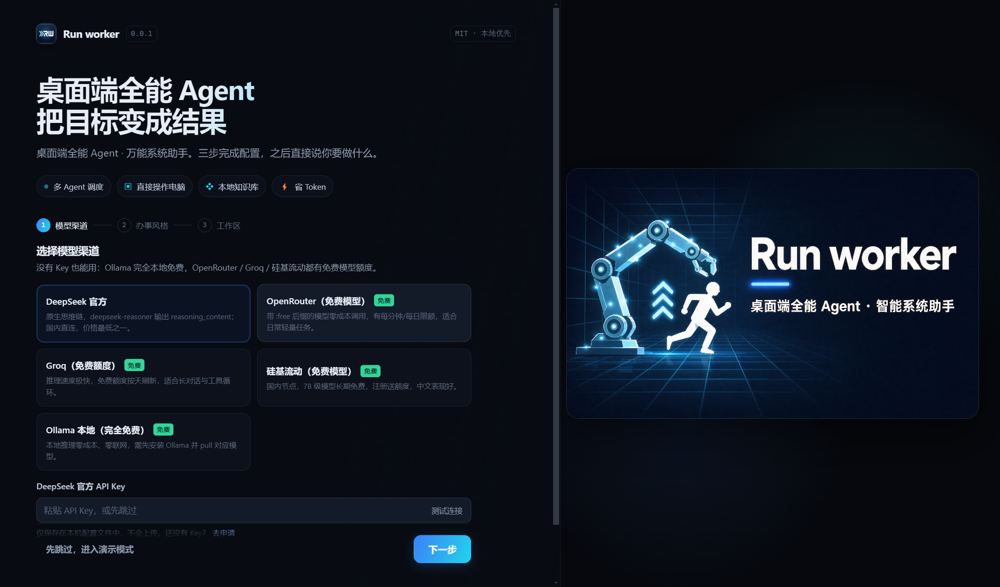
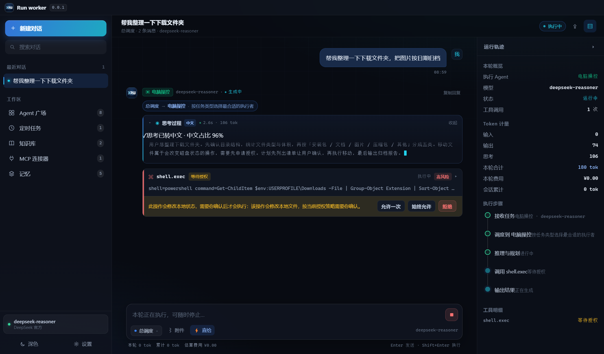
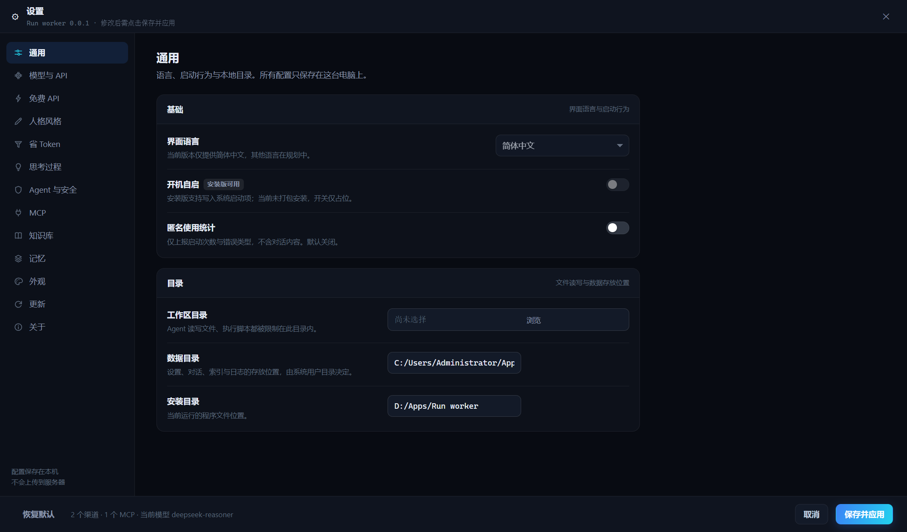
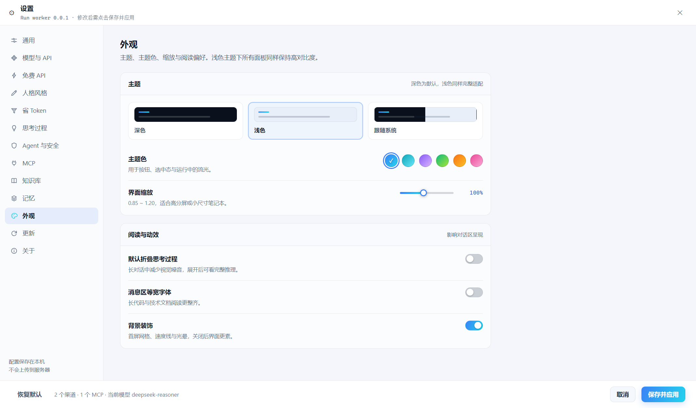

# Run worker

> Language: **English** · [简体中文](README.md)


**A desktop AI agent that gets stuff done. It figures out which helper to call, actually runs the commands, plugs into your MCP tools, and searches your local files — without burning tokens on fluff.**

   

---

## What it can do

| Thing | What you get |
| --- | --- |
| A team of agents | One orchestrator hands your request to 7 specialists — code, images, 3D, video, computer control, research, data |
| Real actions | Reads and writes files, runs shell commands and Python, makes images, edits video, digs through your local docs — you see every step |
| Your choice of model | DeepSeek, free models on OpenRouter, Groq, SiliconFlow, local Ollama — basically anything that speaks the OpenAI API |
| Free out of the box | Six presets ready to go, free-first mode picks a free model for you, or run Ollama locally with zero cost and no internet |
| Local knowledge base | Point it at your folders, ask questions, get answers with citations. Nothing leaves your machine |
| Remembers things | Keeps your preferences and instructions. Hit "Correct this" on a reply and it won't make the same mistake twice |
| Separate workspaces | Every folder has its own memory and files, so projects don't bleed into each other |
| Scheduled jobs | Set it and forget it — cron, intervals, or one-off runs, with results saved to your knowledge base |
| Easy updates | Checks for new versions, downloads, verifies SHA-256, installs quietly. You just click once |
| Easy on tokens | Summarizes old history, trims long tool output, and skips the small talk by default |

## Screenshots

| | |
| --- | --- |
|  |  |
|  |  |

More over in [docs/images](docs/images).

---

## Get going in 3 minutes

**First, get one model provider working.** The setup guide walks you through it: pick a preset, paste your key, hit "Test connection" — if it says `ok`, you're good. Four ways to do this for free:

| Option | Where to get a key | The deal |
| --- | --- | --- |
| OpenRouter free models | <https://openrouter.ai/keys> | Models with a `:free` tag cost nothing |
| Groq | <https://console.groq.com/keys> | Free quota resets daily, and it's fast |
| SiliconFlow | <https://cloud.siliconflow.cn/account/ak> | A bunch of 7B models stay free long-term |
| Ollama at home | No key needed | Run `ollama pull qwen2.5:7b` and you're fully offline |

**Then flip on Free-first** (Settings → Providers → `freeMode`) so it picks free models for you.

**Then just tell it what you want.** Like this:

```
Take every .xlsx under D:\reports, put it in one table, total sales by month,
save it as summary.xlsx, and draw a trend chart.
```

The orchestrator passes that to the Data agent, which scans the folder, crunches the numbers with pandas, saves the file, and draws the chart. You get to watch it happen.

---

## Installing it

Grab `Run-worker-0.0.3d-Windows-x64-setup.exe` (about 81 MB) from [Releases](https://github.com/LHRonline/Run-worker/releases/latest) and double-click it.

| | |
| --- | --- |
| OS | **Windows 10 / 11, 64-bit only** |
| Chip | **x64 / AMD64** — no ARM or 32-bit build, sorry |
| Runtime | **Already included.** Electron brings its own Chromium and Node, so you install nothing else |
| Admin rights | Not needed |

You can pick where it installs, it drops a Desktop shortcut, and uninstalling keeps your chats and settings. Silent-install flags are over in [docs/INSTALL.md](docs/INSTALL.md).

Want to build it yourself? You'll need Node.js 20+:

```bash
git clone https://github.com/LHRonline/Run-worker.git && cd Run-worker
npm install && npm run dev
```

> Heads up: no official builds for macOS, Linux or ARM yet. It's built for Windows and hasn't been tested elsewhere.

---

## Where to go next

- [Get going in 3 minutes](#get-going-in-3-minutes) · [docs/INSTALL.md](docs/INSTALL.md) for install options
- [docs/API.md](docs/API.md) for provider setup and common errors
- [docs/AGENTS.md](docs/AGENTS.md) for what each of the 8 agents is good at
- [CHANGELOG.md](CHANGELOG.md) for what changed between versions

MIT © 2026 Run worker Team
