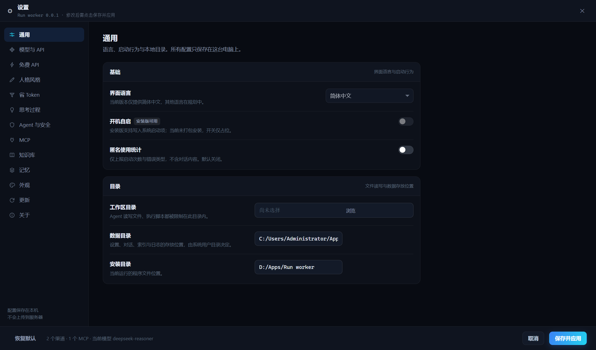
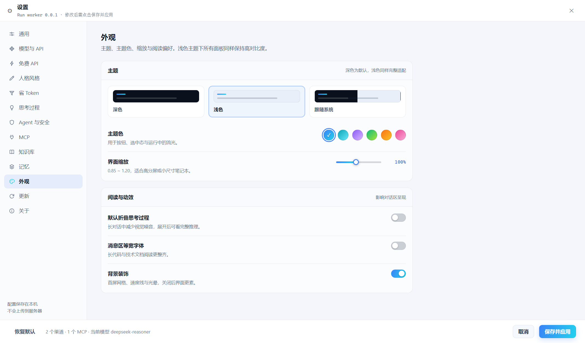

# Run worker

> 语言：**简体中文** · [English](README.en.md)


**一个真正能动手的桌面 Agent：多智能体调度 + 直接操作你的电脑 + MCP 连接器 + 本地知识库，并把 token 花在刀刃上。**

   

---

## 核心特性

| 能力 | 一句话 |
| --- | --- |
| 多 Agent 调度 | 总调度自动把任务分派给代码、图像、3D、视频、电脑操控、研究、数据 7 个专精 Agent |
| 真的动手 | 读写文件、跑 Shell / Python、出图、剪视频、查本地资料，每一步工具调用都可见 |
| 不绑厂商 | DeepSeek、OpenRouter 免费模型、Groq、硅基流动、Ollama 本地，兼容 OpenAI 协议即可 |
| 免费优先 | 内置 6 个渠道预设，一键挑免费模型；Ollama 本地可完全离线零成本 |
| 本地知识库 | 索引你的文件/目录，检索命中带引用返回，数据不出本机 |
| 长期记忆 | 记住偏好、事实、指令；对回复点「纠正」即可持续生效 |
| 工作区隔离 | 每个文件夹各存一份记忆与产物，切换工作区互不串扰 |
| 定时任务 | cron / 间隔 / 单次，结果可写回知识库 |
| 应用内升级 | 检查 → 下载 → SHA-256 校验 → 静默安装，全程有进度 |
| 省 token | 滚动摘要、工具输出截断、直给模式，默认开启 |

## 界面预览

| | |
| --- | --- |
|  |  |
|  |  |

更多截图见 [docs/images](docs/images)。

---

## 3 分钟上手

**第一步：让一个渠道可用。** 首次启动的引导页里选一个预设，粘贴 Key，点「测试连接」返回 `ok` 即可。四条零成本路径：

| 路径 | 获取 Key | 额度 |
| --- | --- | --- |
| OpenRouter 免费模型 | <https://openrouter.ai/keys> | 模型名带 `:free` 后缀，零成本 |
| Groq 免费额度 | <https://console.groq.com/keys> | 按天刷新，推理极快 |
| 硅基流动 | <https://cloud.siliconflow.cn/account/ak> | 部分 7B 模型长期免费 |
| Ollama 本地 | 无需 Key | `ollama pull qwen2.5:7b` 后完全离线 |

**第二步：打开免费优先**（设置 → 模型渠道 → `freeMode`），让应用自动挑免费模型。

**第三步：输入目标，回车。** 例如：

```
把 D:\reports 下所有 .xlsx 汇总成一张表，按月份汇总销售额，
输出 summary.xlsx 并画一张趋势图。
```

总调度会交给「数据分析」Agent：扫目录 → pandas 聚合 → 落盘 → 出图，每步都可见。

---

## 安装

从 [Releases](https://github.com/LHRonline/Run-worker/releases/latest) 下载 `Run-worker-0.0.3d-Windows-x64-setup.exe`（约 81 MB），双击运行。

| 项目 | 要求 |
| --- | --- |
| 操作系统 | **Windows 10 / 11，仅 64 位** |
| 架构 | **x64 / AMD64**，无 ARM64 / 32 位版本 |
| 运行时 | **无需安装**，Electron 已内置 Chromium 与 Node.js |
| 权限 | 普通用户即可，不申请管理员权限 |

安装器可选目录、创建桌面快捷方式，卸载默认保留你的对话与设置。静默安装参数见 [docs/INSTALL.md](docs/INSTALL.md)。

源码运行需 Node.js 20+：

```bash
git clone https://github.com/LHRonline/Run-worker.git && cd Run-worker
npm install && npm run dev
```

> macOS / Linux 与 ARM64 暂无官方安装包，窗口与工具层针对 Windows 适配，其他平台未测试。

---

## 更多文档

- [3 分钟上手](#3-分钟上手) · [docs/INSTALL.md](docs/INSTALL.md) 安装与静默参数
- [docs/API.md](docs/API.md) 渠道配置与常见报错
- [docs/AGENTS.md](docs/AGENTS.md) 8 个 Agent 能做什么
- [CHANGELOG.md](CHANGELOG.md) 版本历史

MIT © 2026 Run worker Team
