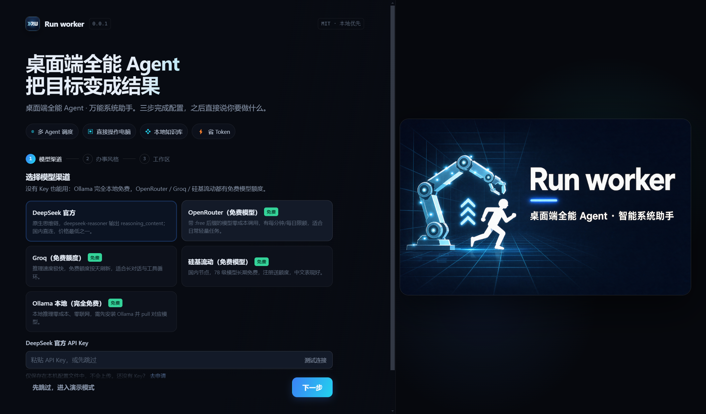
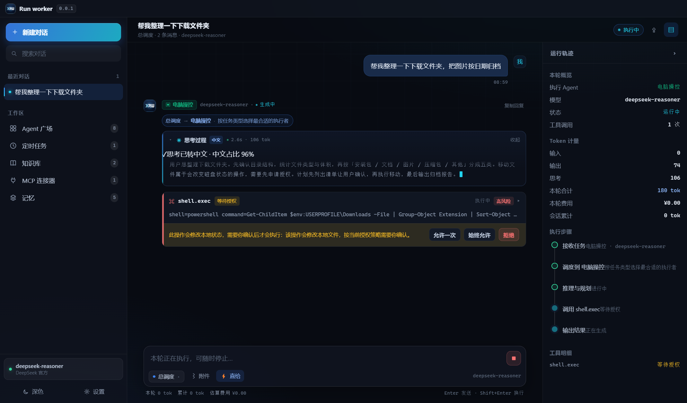
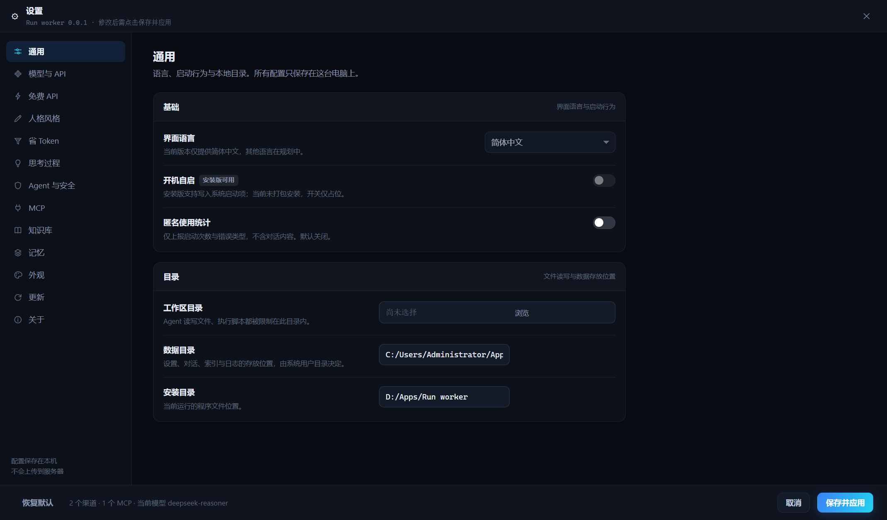
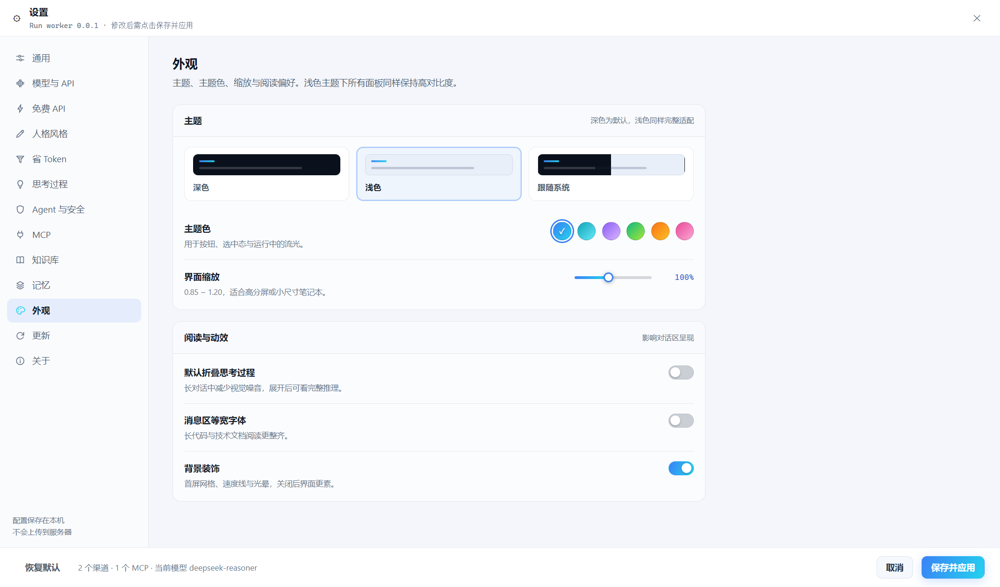
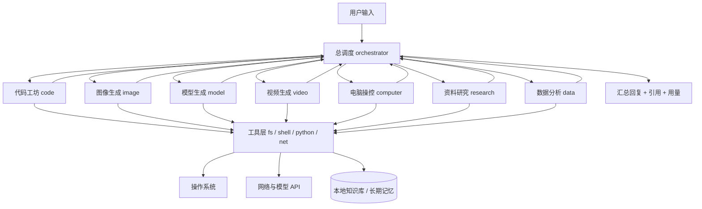

# Run worker


**一个真正能动手的桌面 Agent：多智能体调度 + 直接操作你的电脑 + MCP 连接器 + 本地知识库，并把 token 花在刀刃上。**

    

---

## 这是什么

Run worker 是一个跑在 Windows 桌面上的 AI Agent 客户端。你给一句目标，它自己判断该由哪个子 Agent 接手、该调哪些工具，然后**真的去执行**——写文件、跑命令、出图、生成 3D 资产、剪辑视频、查你的本地资料库。
它不绑定单一厂商：DeepSeek、OpenRouter 免费模型、Groq、硅基流动、Ollama 本地，任何兼容 OpenAI 协议的接口都能接。默认开启省 token 策略与中文思考流式展示，日常轻量任务可以做到零成本。

> 当前版本 **0.0.2**，MIT 协议开源。不知道从哪开始？直接看下面的 [3 分钟上手](#3-分钟上手)，或进 [docs/INSTALL.md](docs/INSTALL.md) 看完整安装教程。

---

## 核心特性

| 能力 | 说明 | 对应 Agent / 设置项 |
| --- | --- | --- |
| 多 Agent 架构 | 总调度接单，按意图路由到 7 个专精子 Agent，串起多步流程 | `orchestrator` + `agent.autoDelegate` |
| 代码生成与修改 | 读写项目文件、生成完整可运行代码、跑构建与测试、定位报错 | `code` |
| 图像生成 | 文生图 / 图生图 / 封面图标，规划构图后落盘 | `image` |
| 3D 模型生成 | 由描述生成模型脚本、导出 `glb`/`obj`、批量处理网格 | `model` |
| 视频生成 | 文生视频、图生视频，ffmpeg 剪辑拼接加字幕转码 | `video` |
| 电脑操控 | 执行 Shell（PowerShell/cmd/bash）与 Python 脚本，管理文件、进程、端口 | `computer` + `agent.approvalMode` |
| MCP 连接器 | 接 stdio / http 两种传输的 MCP Server，工具自动并入工具池 | 设置 → MCP，`mcpServers` |
| 定时任务 | 5 段 cron、固定间隔、单次定时；结果可写入知识库 | `task.schedule`，`ScheduledTask.kind` |
| 本地知识库 | 索引本地目录/文件，检索命中带引用返回 | `kb.search`，`KnowledgeSource` |
| DeepSeek 风格中文流式思考 | `reasoning_content` 实时流式展示，非中文占比超阈值自动重述 | `thinking.forceChinese` / `chineseRatioThreshold` |
| 免费 API 开箱可用 | 内置 6 个渠道预设，免费模型标 `free: true`，可一键免费优先 | `freeMode`，`providers` |
| 主题与个性化 | 深/浅/跟随系统，主题色、缩放、等宽字体、背景装饰 | `appearance` |
| 云端更新检测 | GitHub Release 比对版本，提示下载 | `update.feed` / `update.channel` |
| 长期记忆与历史管理 | 偏好/事实/项目/指令四类记忆，会话置顶、搜索、导出 Markdown | `memory`，`conversations` |
| 直给模式省 token | 不寒暄、不复述、先给结论，配合滚动摘要与工具输出截断 | `persona.noFiller` / `resultFirst` |

## 界面预览

| | |
| --- | --- |
|  |  |
|  |  |

更多截图见 [docs/images](docs/images)（含首页、回复、浅色强制模式共 8 张）。

---

## 安装

### 方式一：安装包（推荐）

从 [Releases](https://github.com/LHRonline/run-worker/releases) 下载 `Run-worker-0.0.2-setup.exe`，双击运行。安装器为 **NSIS 非一键式**：

- 可选安装目录（默认在用户目录下，不强制 `Program Files`），创建桌面与开始菜单快捷方式（名称 `Run worker`）
- 不申请管理员权限（`requestedExecutionLevel: asInvoker`），仅写 `HKCU` 注册表
- 自动写入环境变量：`RUN_WORKER_HOME` = 安装目录，并把安装目录追加到用户 `PATH`；卸载时移除
- 卸载默认**保留**你的对话与设置

静默安装、参数说明、环境变量验证与残留清理见 [docs/INSTALL.md](docs/INSTALL.md)。

### 方式二：源码运行

需要 **Node.js 20+**（Electron 33 对 Node 版本有下限要求）。

```bash
git clone https://github.com/LHRonline/run-worker.git && cd run-worker
npm install
npm run dev        # 开发模式（Vite + Electron 热更新）
npm run build      # 编译主进程 + 打包渲染进程
npm run dist       # 生成 Windows 安装包到 release/
npm test           # 平台集成用例（node:test，当前 14 项）
```

---

## 3 分钟上手

首次启动会进入引导页，核心只有一件事：**让至少一个渠道可用**。四条零成本路径：

| 路径 | 获取 Key | 额度说明 |
| --- | --- | --- |
| **OpenRouter 免费模型** | <https://openrouter.ai/keys> | 模型名带 `:free` 后缀零成本，有每分钟/每日调用限额 |
| **Groq 免费额度** | <https://console.groq.com/keys> | 按天刷新的免费额度，推理速度极快，适合工具循环 |
| **硅基流动免费模型** | <https://cloud.siliconflow.cn/account/ak> | 7B 级模型长期免费，注册送额度，国内节点延迟低 |
| **Ollama 本地** | 无需 Key | 本地推理零成本零联网，需先 `ollama pull qwen2.5:7b` |

配置步骤：

1. 打开 **设置 → 模型渠道**，选中一个预设（例如 `OpenRouter（免费模型）`），粘贴 API Key，点 **测试连接**——返回 `ok` 即可用。
2. 在模型下拉里选一个带 `:free` 的模型，或直接打开 **免费优先（`freeMode`）** 让应用自动挑。
3. 回主界面，输入目标，回车。

真实使用示例：

```
把 D:\reports 下所有 .xlsx 汇总成一张表，按月份汇总销售额，
输出 summary.xlsx 并画一张趋势图。
```

总调度会把它交给 **数据分析** Agent：`fs.list` 扫目录 → `python.exec` 跑 pandas 聚合 → `fs.write` 落盘 → `data.chart` 出图，过程中每一步工具调用都在界面上可见。

## 多 Agent 架构



一次对话的时序：

1. **路由**：总调度解析目标。命中关键词或明确能力需求时切到专精子 Agent；你手动选中某个子 Agent 时**手动优先**，不路由也不发 `run:routing`（选「总调度」则仍会自动分派）。路由只影响本轮执行者、不改变会话基线，同一会话每轮都可重新分派；只有你手动选择子 Agent 才会钉住该会话。
2. **工具循环**：子 Agent 请求工具 → 权限层判定 → 必要时弹出审批 → 执行 → 结果回灌模型，最多 `agent.maxSteps` 步（默认 12）。
3. **汇总**：总调度整合子 Agent 输出，附上知识库引用与 token 用量，落库为一条消息。

细节见 [docs/ARCHITECTURE.md](docs/ARCHITECTURE.md) 与 [docs/AGENTS.md](docs/AGENTS.md)。

## 省 Token 与成本

默认开启，可在 **设置 → Token 节省** 逐项关闭。六条机制：

| 机制 | 字段 | 默认值 | 作用 |
| --- | --- | --- | --- |
| 历史消息上限 | `maxHistoryMessages` | 16 | 只带最近 N 条，超出的进摘要 |
| 滚动摘要压缩 | `compressThreshold` | 24000 字符 | 超阈值把旧对话压成一条 `summary` 消息 |
| 工具输出截断 | `toolOutputLimit` | 4000 字符 | 长日志只留头尾，避免撑爆上下文 |
| 不回传 reasoning | `skipReasoningResend` | 开启 | 思考内容只展示不给模型，符合 DeepSeek 官方建议 |
| 单次输出上限 | `maxOutputTokens` | 4096 | 防跑飞，控制单轮花费 |
| 前缀缓存友好 | `cacheFriendlyPrefix` | 开启 | 系统提示前缀稳定，提升缓存命中（`cachedTokens`） |

**直给模式**（`persona.preset = 'direct'`，默认）：禁止寒暄、免责声明、复述问题，优先给可执行结论与代码。它不改变正确性，只砍掉包装。

| 场景 | 默认 / 平衡风格 | 直给模式 |
| --- | --- | --- |
| 同一技术问题的回复长度 | 含铺垫、举例、总结段 | 结论 + 代码，通常明显更短 |
| 工具循环轮次 | 倾向于先解释再调用 | 直接调用工具，减少空转轮 |
| 累计 token 消耗与可读性 | 中高，信息完整 | 低，精简，适合熟练用户 |

另有预算告警 `budgetAlertCny`（元，默认 20，`0` 表示不限制），累计估算成本超线时提示。

---

## 配置与数据位置

所有数据都在本地 `%APPDATA%/Run worker/`（即 `AppInfo.userData`）：

| 路径 | 内容 |
| --- | --- |
| `settings.json` | 唯一的配置文件：`version: 1` + `providers` / `appearance` / `persona` / `tokenSave` / `thinking` / `memory` / `agent` / `mcpServers` / `update` / `onboardingDone`。MCP 服务器配置也存在这里的 `mcpServers`，没有单独的配置文件 |
| `conversations/index.json` | 会话索引（标题、置顶、时间、用量） |
| `conversations/<id>.json` | 单个会话正文（消息、思考、工具调用、引用） |
| `kb/` | 知识库索引与分块（`index.json`） |
| `memory/` | 长期记忆条目（`facts.json`） |
| `tasks/` | 定时任务表 `tasks.json` 与执行历史 `history.json`（上限 100 条） |
| `task-output/` | 定时任务输出 `<taskId>-<ISO时间戳>.md`，仅在勾选 `indexResult` 且执行成功时生成（按需创建） |
| `update/` | 更新检测缓存 `cache.json` |
| `logs/main-YYYY-MM-DD.log` | 按天切分的主进程日志（不含 API Key） |
| `workspace/` | Agent 默认工作目录（可在设置里改 `agent.workspaceDir`） |
| `artifacts/` | 生成的图片、图表、视频、3D 资产 |

同目录下的 `Cache/`、`Code Cache/`、`GPUCache/`、`Local Storage/`、`Network/`、`Preferences`、`Local State`、`blob_storage/`、`Session Storage/`、`tmp/` 是 **Chromium 自身缓存，不属于应用数据**，可安全删除（删了会丢登录态与窗口状态，不影响对话与设置）。

- **备份**：直接复制整个 `%APPDATA%/Run worker/` 目录即可。
- **删除单个对话**：左侧会话列表右键 → 删除；**清空全部历史**：设置 → 数据 → 清空对话（`conv:clear`）。
- **清空记忆**：设置 → 记忆 → 全部清除（`memory:clear`）；单条可点垃圾桶。**重置设置**：设置 → 通用 → 恢复默认（`settings:reset`），不会删对话。

## 使用教程

| 教程 | 内容 |
| --- | --- |
| [3 分钟上手](#3-分钟上手) | 配渠道 → 发第一句话 → 让 Agent 真的干活 |
| [docs/INSTALL.md](docs/INSTALL.md) | 安装、静默安装 `/S /D=`、环境变量与目录布局 |
| [docs/API.md](docs/API.md) | 渠道配置：免费路径、Key 获取、常见报错处理 |
| [docs/AGENTS.md](docs/AGENTS.md) | 8 个 Agent 各自能做什么、什么时候手动指定 |
| [docs/ARCHITECTURE.md](docs/ARCHITECTURE.md) | 数据与配置文件放哪、怎么备份与清理 |

版本变更历史见 [CHANGELOG.md](CHANGELOG.md)。

---

## 开发

```text
src/            源码
├─ main/        主进程：index.ts 入口、env.ts 环境探测、store.ts 持久化
│  ├─ chat/     运行生命周期（路由 → 工具循环 → 汇总）
│  ├─ llm/      OpenAI 兼容客户端、提示词、中文思考、计价
│  ├─ tools/    工具实现（fs / shell / python / net / kb / mcp）
│  ├─ agents/   Agent 定义与调度
│  └─ platform/ mcp、scheduler、knowledge、memory、updater、permissions
├─ preload/     白名单桥接（contextBridge）
├─ renderer/    React 界面
└─ shared/      三方共用契约 types / ipc / agents / presets / platform
build/          NSIS 脚本与图标        assets/  README 横幅与图标
docs/           安装、API、Agent、架构等使用教程
scripts/        dev / preview / 资源处理   tests/  node:test 用例
electron-builder.yml                   打包配置
```

脚本：

| 命令 | 作用 |
| --- | --- |
| `npm run dev` | 启动 Vite 开发服务并拉起 Electron（端口 5173，`strictPort`） |
| `npm run typecheck` | 渲染进程 + 主进程双份 `tsc --noEmit` |
| `npm run build` | `build:main`（tsc → `dist-electron/`） + `build:renderer`（Vite → `dist/renderer/`） |
| `npm run pack` | 免安装目录（`--dir`），用于快速验证产物 |
| `npm run dist` | 生成 NSIS 安装包到 `release/` |
| `npm test` | 跑 `node --test tests/*.test.mjs`，当前 14 项平台集成用例 |
| `npm run test:e2e` | 真实 Electron 端到端验证：先 `tsc` + `vite build`，再跑 26 项断言，全绿输出 `ALL PASS (26/26)`，无需任何 API Key；`test:e2e:only` 跳过构建只重跑断言 |
| `npm run test:packaged` | 打包产物验证：在 `release-<版本>/`、`release/`、`dist/` 中自动选 `app.asar` 最新的一份 win-unpacked（可用 `RUNWORKER_E2E_EXE` 指定），真实启动并做 11 项 CDP 断言，全绿输出 `PACKAGED PASS (11/11)`；需先 `npm run pack` 或 `npm run dist` |

代码规范：TypeScript `strict`，共享类型只写在 `src/shared/`；主进程不直接读写 `window`，渲染进程不直接 `require`；新增 IPC 必须同时改 `src/shared/ipc.ts` 与 `src/preload/index.ts`；文件写入走 `writeJsonAtomic`。

扩展方式：

- **加子 Agent**：在 `src/shared/agents.ts` 的 `AGENTS` 追加描述（`id` 需同步进 `AgentId` 联合类型），在 `src/main/agents/` 注册路由规则与工具白名单。
- **加工具**：在 `src/main/tools/` 实现 `name/description/inputSchema/run`，注册进工具池；危险工具需在 `platform/permissions.ts` 里给风险等级。
- **加 MCP**：设置 → MCP → 新增，填 `transport: stdio`（`command`+`args`）或 `http`（`url`+`headers`），连接成功后工具自动可见。

想先学会用再动手改？从 [3 分钟上手](#3-分钟上手) 和 [docs/API.md](docs/API.md) 开始；贡献流程见 [CONTRIBUTING.md](CONTRIBUTING.md)。

## FAQ

**没有 API Key 能用吗？**
能。装 Ollama 后选 `Ollama 本地（完全免费）` 预设，`baseUrl` 是 `http://localhost:11434/v1`，无需 Key。纯离线可用，质量取决于本地模型。

**免费额度有什么限制？**
OpenRouter 的 `:free` 模型有每分钟/每日请求上限；Groq 按天刷新；硅基流动送额度且部分小模型长期免费。超限会返回 `429`，换渠道或等额度刷新。

**让 AI 执行命令安全吗？**
默认 `approvalMode: 'safe-only'`：高风险命令（`rm -rf`、`format`、`diskpart`、`shutdown`、注册表删除等）必须你点确认才执行；命中 `agent.denyPatterns` 黑名单直接拒绝。可改成 `always`（每条都问）或 `never`（全放行，不建议）。

**会上传我的文件吗？**
不会主动上传。文件内容只在两种情况下离开本机：作为对话上下文发给**你自己配置的模型 API**，或你显式让 Agent 调用 `net.fetch`。知识库索引、记忆、日志全部存本地 `%APPDATA%/Run worker/`。匿名统计 `telemetry` 默认关闭。

**更新怎么检测？**
启动时按 `update.autoCheck` 后台检查，比对 `update.feed`（默认 `LHRonline/run-worker`）的 GitHub Release 版本号，有新版本在设置页提示并可跳转下载。当前为检测 + 手动下载安装，不做静默替换。

## License

[MIT](LICENSE) © 2026 Run worker Team

感谢 Electron、React、Vite 与所有兼容 OpenAI 协议的模型服务提供方；感谢 DeepSeek 公开的 `reasoning_content` 约定，让中文思考流式展示成为可能。
