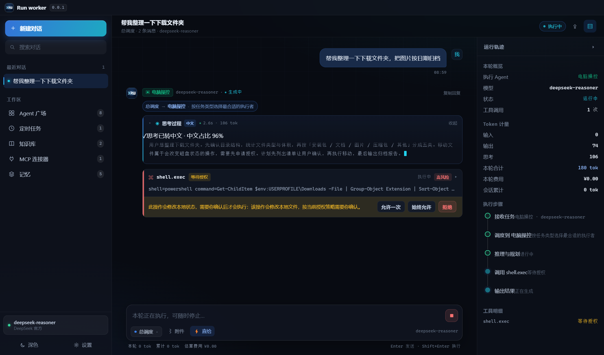
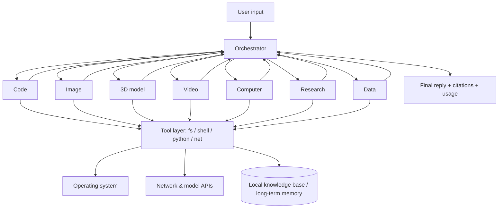

# Run worker

> Language: **English** · [简体中文](README.zh-CN.md)


**A desktop Agent that actually does the work: multi-agent orchestration, real control of your machine, MCP connectors, and a local knowledge base — without wasting tokens.**

    

---

## What is it

Run worker is an AI Agent client for the Windows desktop. Give it a goal and it decides which sub-agent should take it, which tools to call, and then **actually executes** — writing files, running commands, generating images and 3D assets, editing video, and searching your local knowledge base.

It is not tied to one vendor: DeepSeek, free models on OpenRouter, Groq, SiliconFlow, local Ollama — any OpenAI-compatible endpoint works. Token-saving strategies and streaming Chinese reasoning are on by default, so lightweight day-to-day tasks can cost nothing.

> Current version **0.0.3d**, MIT licensed. New here? Jump to [Get started in 3 minutes](#get-started-in-3-minutes), or read [docs/INSTALL.md](docs/INSTALL.md) for the full installation guide.

---

## Features

| Capability | What it does | Agent / setting |
| --- | --- | --- |
| Multi-agent architecture | An orchestrator routes your request to 7 specialist agents and chains multi-step workflows | `orchestrator` + `agent.autoDelegate` |
| Code generation & editing | Reads/writes project files, produces runnable code, runs builds and tests, diagnoses errors | `code` |
| Image generation | Text-to-image, image-to-image, covers and icons, with planned composition saved to disk | `image` |
| 3D model generation | Turns a description into model scripts, exports `glb`/`obj`, batch-processes meshes | `model` |
| Video generation | Text-to-video, image-to-video, ffmpeg cutting/merging, subtitles and transcoding | `video` |
| Computer control | Runs Shell (PowerShell/cmd/bash) and Python, manages files, processes and ports | `computer` + `agent.approvalMode` |
| MCP connectors | Connects stdio / http MCP servers; their tools join the shared tool pool | Settings → MCP, `mcpServers` |
| Scheduled tasks | 5-field cron, fixed intervals, one-shot timers; results can be indexed into the knowledge base | `task.schedule`, `ScheduledTask.kind` |
| Local knowledge base | Indexes local directories/files; retrieval hits come back with citations | `kb.search`, `KnowledgeSource` |
| DeepSeek-style Chinese reasoning | Streams `reasoning_content` live; auto-rewrites when the non-Chinese ratio is too high | `thinking.forceChinese` / `chineseRatioThreshold` |
| Free APIs out of the box | 6 built-in provider presets, free models flagged `free: true`, one-click free-first mode | `freeMode`, `providers` |
| Themes & personalization | Dark / light / follow-system, accent color, zoom, monospace font, background decor | `appearance` |
| In-app one-click update | Check → download → SHA-256 verify → silent install, with progress throughout | Settings → Update, `update.feed` / `update.channel` |
| Long-term memory & history | preference / fact / project / instruction memories, pin, search, Markdown export | `memory`, `conversations` |
| Thorough conversation deletion | Removes conversation files, index, derived memories and artifacts together, and aborts in-flight work | Sidebar "Delete permanently" / "Clear all" |
| Enhanced composer menu | Attach files, re-reference conversation files, mode, agent, skills and connectors in one place | The `＋` button left of the input |
| Accurate token metering | Accumulates provider usage per round, labels exact vs estimated, no `k`/`M` abbreviations | Composer footer, messages, trace panel |
| Self-improvement & natural tone | Submit a correction on any reply and it becomes a high-priority long-term memory; humanized persona | Reply → "Correct this", `persona.humanize` |
| Direct mode to save tokens | No filler, no restating, conclusions first — plus rolling summaries and truncated tool output | `persona.noFiller` / `resultFirst` |

## Screenshots

| | |
| --- | --- |
|  |  |
|  |  |

More screenshots in [docs/images](docs/images) (8 images in total).

---

## Installation

### Option 1: installer (recommended)

Download `Run-worker-0.0.3d-Windows-x64-setup.exe` (about 81 MB) from [Releases](https://github.com/LHRonline/Run-worker/releases/latest) and run it. The `Windows-x64` in the filename is the supported OS and architecture.

**Runtime requirements (check before downloading)**

| Item | Requirement |
| --- | --- |
| Operating system | **Windows 10 / 11, 64-bit only**. The installer shell is a 32-bit NSIS stub, but the application itself is x64 — it will not install or run on 32-bit Windows. |
| CPU architecture | **x64 / AMD64**. No ARM64 or 32-bit builds are provided. |
| Runtime | **Nothing to install.** Electron 33.4.11 bundles Chromium and Node.js; you do not need Node, .NET or Python on the machine. |
| Network | Needed only to configure a model provider; choose a local Ollama model to run fully offline. |
| Permissions | Standard user is enough; no administrator privileges requested. |

The installer uses **NSIS in interactive (non-one-click) mode**:

- Choose the install directory (defaults to your user profile, not `Program Files`); creates Desktop and Start Menu shortcuts named `Run worker`
- Does not request elevation (`requestedExecutionLevel: asInvoker`) and writes only to `HKCU`
- Sets `RUN_WORKER_HOME` to the install directory and appends it to the user `PATH`; removes both on uninstall
- Keeps your conversations and settings by default on uninstall

Silent install flags, environment variables and cleanup are documented in [docs/INSTALL.md](docs/INSTALL.md).

> There are no official builds for macOS, Linux or ARM64. You can build from source below, but the window and tool layers are Windows-oriented and other platforms are untested.

### Option 2: run from source

Requires **Node.js 20+** and npm (only for development or building from source — the installer needs neither). Windows 10/11 x64 is recommended; other platforms are untested.

```bash
git clone https://github.com/LHRonline/Run-worker.git && cd Run-worker
npm install
npm run dev        # Dev mode (Vite + Electron hot reload)
npm run build      # Compile main process + bundle renderer
npm run dist       # Produce a Windows x64 installer in release/
npm test           # Unit tests (node:test, 62 cases)
```

---

## Get started in 3 minutes

The first launch opens a setup guide with one goal: **make at least one provider usable**. Four free paths:

| Path | Get a key | Quota |
| --- | --- | --- |
| **OpenRouter free models** | <https://openrouter.ai/keys> | Models ending in `:free` cost nothing, with per-minute / per-day limits |
| **Groq free tier** | <https://console.groq.com/keys> | Daily-refreshing free quota, very fast inference — great for tool loops |
| **SiliconFlow free models** | <https://cloud.siliconflow.cn/account/ak> | Long-term-free 7B-class models, low latency in China |
| **Ollama local** | No key needed | Fully local and offline; first run `ollama pull qwen2.5:7b` |

Steps:

1. Open **Settings → Providers**, pick a preset (e.g. `OpenRouter (free models)`), paste your API key and click **Test connection** — `ok` means it works.
2. Choose a model with a `:free` suffix, or turn on **Free-first (`freeMode`)** to let the app pick one.
3. Return to the main view, type a goal and press Enter.

A real example:

```
Summarize every .xlsx under D:\reports into one table, aggregate sales by month,
save summary.xlsx and draw a trend chart.
```

The orchestrator hands this to the **Data** agent: `fs.list` scans the folder → `python.exec` runs pandas → `fs.write` saves the result → `data.chart` draws the figure. Every tool call is visible as it happens.

## Multi-agent architecture



The flow for one turn:

1. **Routing.** The orchestrator reads the goal. A keyword or clear capability need switches to a specialist; a manual agent selection takes priority — no routing and no `run:routing` event (choosing "Orchestrator" keeps auto-routing). Routing only affects the current turn; manual selection pins the conversation.
2. **Tool loop.** The agent requests a tool → the permission layer checks it → approval is requested when needed → the tool runs → the result is fed back, up to `agent.maxSteps` steps (12 by default).
3. **Summary.** The orchestrator combines the sub-agent output with knowledge-base citations and token usage, and saves it as a single message.

See [docs/ARCHITECTURE.md](docs/ARCHITECTURE.md) and [docs/AGENTS.md](docs/AGENTS.md) for details.

## Token saving and cost

All six strategies are on by default and can be turned off in **Settings → Token Saving**:

| Strategy | Field | Default | Effect |
| --- | --- | --- | --- |
| History limit | `maxHistoryMessages` | 16 | Only the latest N messages are sent; older ones are summarized |
| Rolling summary | `compressThreshold` | 24000 chars | Compresses older messages into one `summary` message |
| Tool output truncation | `toolOutputLimit` | 4000 chars | Keeps only the head and tail of long logs |
| No reasoning resend | `skipReasoningResend` | on | Reasoning is shown but not sent back, per DeepSeek's recommendation |
| Output cap | `maxOutputTokens` | 4096 | Prevents runaway generation and controls cost |
| Cache-friendly prefix | `cacheFriendlyPrefix` | on | Stable system-prompt prefix improves cache hits (`cachedTokens`) |

**Direct mode** (`persona.preset = 'direct'`, default) forbids pleasantries, disclaimers and restating the question, and leads with actionable conclusions and code. It changes packaging, not correctness.

| Scenario | Default / balanced | Direct mode |
| --- | --- | --- |
| Reply length for a technical question | Intro, examples, summary | Conclusion + code, usually much shorter |
| Tool loop behavior | Explains first, then calls | Calls directly, fewer idle rounds |
| Token use vs. readability | Medium-high, complete | Low, concise, for experienced users |

There is also a budget alert `budgetAlertCny` (CNY, default 20; `0` disables it) that warns when accumulated estimated cost crosses the line.

---

## Configuration and data locations

All data lives locally in `%APPDATA%/Run worker/` (`AppInfo.userData`):

| Path | Contents |
| --- | --- |
| `settings.json` | The only config file: `version: 1` plus `providers` / `appearance` / `persona` / `tokenSave` / `thinking` / `memory` / `agent` / `mcpServers` / `update` / `onboardingDone`. MCP server config lives in `mcpServers` here — there is no separate file. |
| `conversations/index.json` | Conversation index (title, pinned, timestamps, usage) |
| `conversations/<id>.json` | One conversation (messages, reasoning, tool calls, citations) |
| `kb/` | Knowledge-base index and chunks (`index.json`) |
| `memory/` | Long-term memories (`facts.json`) |
| `tasks/` | Schedule table `tasks.json` and run history `history.json` (100 entries max) |
| `task-output/` | Scheduled task output `<taskId>-<ISO timestamp>.md`, only when `indexResult` is checked and the run succeeded (created on demand) |
| `update/` | Update-check cache `cache.json` |
| `logs/main-YYYY-MM-DD.log` | Daily main-process logs (no API keys) |
| `workspace/` | Default agent working directory (change with `agent.workspaceDir`) |
| `artifacts/` | Generated images, charts, videos and 3D assets |

The `Cache/`, `Code Cache/`, `GPUCache/`, `Local Storage/`, `Network/`, `Preferences`, `Local State`, `blob_storage/`, `Session Storage/` and `tmp/` entries alongside them are **Chromium's own caches, not application data**. They are safe to delete (you lose login/window state, not conversations or settings).

- **Backup:** copy the whole `%APPDATA%/Run worker/` directory.
- **Delete one conversation:** right-click it in the sidebar → Delete. **Clear all history:** Settings → Data → Clear conversations (`conv:clear`).
- **Clear memory:** Settings → Memory → Clear all (`memory:clear`); individual entries have a trash icon. **Reset settings:** Settings → General → Restore defaults (`settings:reset`), which keeps conversations.

## Documentation

| Guide | Covers |
| --- | --- |
| [Get started in 3 minutes](#get-started-in-3-minutes) | Configure a provider → send the first request → let the agent work |
| [docs/INSTALL.md](docs/INSTALL.md) | Installation, silent install `/S /D=`, environment variables and directory layout |
| [docs/API.md](docs/API.md) | Provider setup: free paths, getting keys, common errors |
| [docs/AGENTS.md](docs/AGENTS.md) | What each of the 8 agents does and when to select one manually |
| [docs/ARCHITECTURE.md](docs/ARCHITECTURE.md) | Where data and config live, and how to back up or clean them |

Version history is in [CHANGELOG.md](CHANGELOG.md). The [Chinese README](README.zh-CN.md) has the same content in 简体中文.

---

## Development

```text
src/            source
├─ main/        main process: index.ts, env.ts, store.ts
│  ├─ chat/     run lifecycle (routing → tool loop → summary)
│  ├─ llm/      OpenAI-compatible client, prompts, Chinese reasoning, pricing
│  ├─ tools/    fs / shell / python / net / kb / mcp
│  ├─ agents/   agent definitions and routing rules
│  └─ platform/ mcp, scheduler, knowledge, memory, updater, permissions
├─ preload/     whitelisted bridge (contextBridge)
├─ renderer/    React UI
└─ shared/      shared contracts: types / ipc / agents / presets / platform
build/          NSIS script and icons      assets/  README banner and icons
docs/           install, API, agents, architecture guides
scripts/        dev / preview / asset tools   tests/  node:test suites
electron-builder.yml                   packaging config
```

Scripts:

| Command | Purpose |
| --- | --- |
| `npm run dev` | Start Vite and Electron with hot reload (port 5173, `strictPort`) |
| `npm run typecheck` | `tsc --noEmit` for both renderer and main process |
| `npm run build` | `build:main` (tsc → `dist-electron/`) + `build:renderer` (Vite → `dist/renderer/`) |
| `npm run pack` | Unpacked directory (`--dir`) for quick verification |
| `npm run dist` | Produce a Windows x64 NSIS installer in `release/` |
| `npm test` | Run `node --test tests/*.test.mjs` — 62 unit tests |
| `npm run test:e2e` | Real Electron end-to-end checks: `tsc` + `vite build`, then 32 assertions, ending in `ALL PASS (32/32)`. No API key needed; `test:e2e:only` skips the build |
| `npm run test:packaged` | Packaged-artifact checks: picks the newest `app.asar` among `release-<version>/`, `release/`, `dist/` (override with `RUNWORKER_E2E_EXE`), starts the real exe and runs 14 CDP assertions, ending in `PACKAGED PASS (14/14)`. Run `npm run pack` or `npm run dist` first |

Conventions: TypeScript `strict`; shared types belong in `src/shared/`; the main process never touches `window` and the renderer never `require`s Node modules; every new IPC channel must be added to both `src/shared/ipc.ts` and `src/preload/index.ts`; file writes go through `writeJsonAtomic`.

Extending it:

- **Add an agent:** append a description to `AGENTS` in `src/shared/agents.ts` (add the `id` to the `AgentId` union), then register routing rules and a tool whitelist in `src/main/agents/`.
- **Add a tool:** implement `name/description/inputSchema/run` under `src/main/tools/`, register it in the tool pool; mark its risk level in `platform/permissions.ts` if it is dangerous.
- **Add MCP:** Settings → MCP → Add, choose `transport: stdio` (`command` + `args`) or `http` (`url` + `headers`); tools appear automatically once connected.

New to it? Start with [Get started in 3 minutes](#get-started-in-3-minutes) and [docs/API.md](docs/API.md). Contribution flow: [CONTRIBUTING.md](CONTRIBUTING.md).

## FAQ

**Can I use it without an API key?**
Yes. Install Ollama, select the `Ollama local (completely free)` preset, and set `baseUrl` to `http://localhost:11434/v1`. No key needed, fully offline; quality depends on the local model.

**What are the limits of the free tiers?**
OpenRouter `:free` models have per-minute/per-day request caps; Groq refreshes daily; SiliconFlow gives credits and keeps some small models free long-term. Exceeding a cap returns `429` — switch providers or wait for the quota to refresh.

**Is it safe to let AI run commands?**
The default `approvalMode: 'safe-only'` requires your confirmation for high-risk commands (`rm -rf`, `format`, `diskpart`, `shutdown`, registry deletions, etc.); anything matching `agent.denyPatterns` is refused. You can switch to `always` (ask for everything) or `never` (allow all — not recommended).

**Will my files be uploaded?**
Not proactively. File content leaves the machine only when it is sent as context to **a provider you configured yourself**, or when you explicitly ask the agent to call `net.fetch`. The knowledge-base index, memories and logs all stay in `%APPDATA%/Run worker/`. Anonymous telemetry is off by default.

**How are updates detected?**
On startup it checks `update.feed` (default `LHRonline/run-worker`) against GitHub Releases in the background per `update.autoCheck`. A hint appears in the sidebar; open Settings → Update and click "Download and install": the app downloads the installer, verifies the published SHA-256, then launches the silent installer and exits to complete the upgrade. Nothing starts without your confirmation, and "Open download page" is available for manual upgrades.

**Is my data still there after deleting a conversation?**
"Delete permanently" removes the conversation file and index entry, the long-term memories derived from it (including your corrections), and its artifact files. In-flight work is aborted so nothing writes it back. Old-style loose files in the artifact root are cleaned too. The UI reports how many items were actually removed, and clearly warns if a file was locked and could not be deleted.

## License

[MIT](LICENSE) © 2026 Run worker Team

Thanks to Electron, React, Vite and every OpenAI-compatible provider; and to DeepSeek for publishing the `reasoning_content` convention that makes streaming Chinese reasoning possible.
