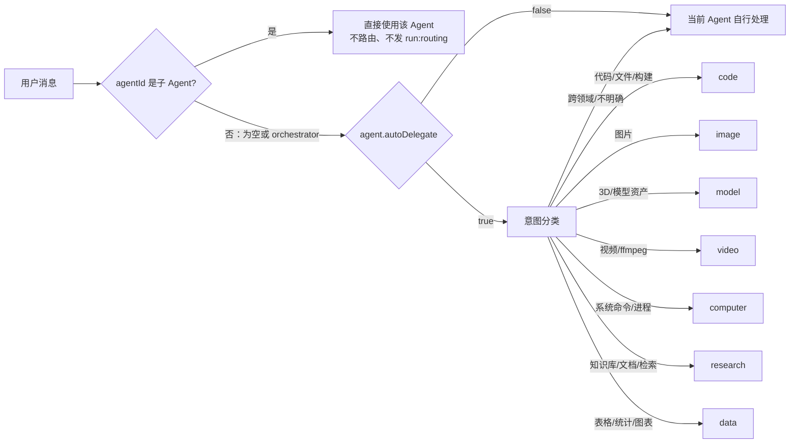

# Agent 手册

Run worker 由一个总调度和 7 个专精子 Agent 组成，清单定义在 `src/shared/agents.ts`（`AGENTS` 数组 + `AGENT_MAP` 索引）。
`AgentId` 联合类型定义在 `src/shared/types.ts`，新增 Agent 必须两处同步。

---

## 1. 总览

| id | 名称 | 一句话 | 关键工具 | 特殊要求 |
| --- | --- | --- | --- | --- |
| `orchestrator` | 总调度 | 理解任务、拆解步骤、分派子 Agent | `fs.list` `fs.read` `kb.search` `memory.save` `task.schedule` `mcp.call` | 所有对话默认由它接单 |
| `code` | 代码工坊 | 写代码、改项目、跑测试、修 Bug | `fs.list` `fs.read` `fs.write` `shell.exec` `python.exec` `net.fetch` | — |
| `image` | 图像生成 | 文生图、图生图、封面与图标设计 | `image.generate` `fs.write` `fs.read` | `requiresImageGen: true` |
| `model` | 模型生成 | 文本生成 3D 模型与资产管线 | `model.generate` `python.exec` `fs.write` | — |
| `video` | 视频生成 | 文生视频、图生视频、剪辑与转码 | `video.generate` `shell.exec` `ffmpeg` `fs.write` | `requiresImageGen: true` |
| `computer` | 电脑操控 | 执行 Shell/Python、管理文件与进程 | `shell.exec` `python.exec` `fs.list` `fs.read` `fs.write` `fs.delete` | 唯一带 `fs.delete` |
| `research` | 资料研究 | 查知识库、读文档、联网检索并给出结论 | `kb.search` `net.fetch` `fs.read` `memory.save` | — |
| `data` | 数据分析 | 表格清洗、统计分析、图表生成 | `python.exec` `fs.read` `fs.write` `data.chart` | — |

工具名的权威来源是各 Agent 的 `tools` 字段；主进程按此字段裁剪可用工具集。

---

## 2. 逐个说明

### 2.1 总调度 `orchestrator`

- **职责**：解析你的目标、判断该由谁执行、串多步流程、对最终结果负责；同时是自己也能干活的执行者（读文件、查知识库、存记忆、排任务、调 MCP）。
- **适用场景**：目标模糊或跨领域（“先查资料再写个脚本跑一遍”）、需要多 Agent 串联、需要定时化。
- **不适用**：明确的单点技术任务——直接指定子 Agent 更快更省 token。
- **输出特征**：给出路由理由（`run:routing.reason`），汇总各子 Agent 结果，附引用与用量。

### 2.2 代码工坊 `code`

- **职责**：读写项目文件、生成完整可运行代码、执行构建与测试命令、定位并修复报错。默认先读结构再动手。
- **适用场景**：新增功能、重构、修 Bug、写脚本、跑 `npm test` 之类的验证。
- **风险点**：`shell.exec` 会跑真实命令，默认走审批。
- **提示词建议**：明确语言/框架版本与验收命令，例如“改完跑 `npm run typecheck` 并把错误贴出来”。

### 2.3 图像生成 `image`

- **职责**：把自然语言或参考图变成图片文件。先规划构图与风格，再调图像接口或本地脚本产出。
- **适用场景**：封面、图标、插画、产品图、批量出图。
- **依赖**：需要支持图像生成的模型或 MCP（`requiresImageGen`）；未配置时会在 `run:notice` 提示。
- **产物位置**：`artifacts/` 或 `agent.workspaceDir`。

### 2.4 模型生成 `model`

- **职责**：3D 资产管线——根据描述生成模型脚本、导出 `glb`/`obj`、批量处理网格与材质，可对接外部 3D 生成 MCP。
- **适用场景**：原型资产、批量格式转换、参数化建模。
- **依赖**：本地 Python 环境（`agent.pythonPath`）或 3D 类 MCP。

### 2.5 视频生成 `video`

- **职责**：生成短视频、图片转动镜头，或用 ffmpeg 剪辑、拼接、加字幕、转码，输出可直接播放的 `mp4`。
- **适用场景**：图生视频、切片拼接、字幕烧录、格式转换。
- **依赖**：ffmpeg 在 `PATH` 中（安装器会尝试把安装目录下的 `tools/`、`bin/` 注入 `PATH`）。

### 2.6 电脑操控 `computer`

- **职责**：真正“能动手”——执行系统命令、跑 Python、批量整理文件、查看进程与端口。危险操作先申请授权。
- **适用场景**：批量重命名、清理磁盘、查端口占用、装依赖、跑一次性脚本。
- **风险点**：唯一拥有 `fs.delete` 的 Agent，删除操作务必确认路径。
- **相关设置**：`agent.approvalMode`、`agent.shell`（`powershell` / `cmd` / `bash`）、`agent.commandTimeout`、`agent.denyPatterns`。

### 2.7 资料研究 `research`

- **职责**：基于本地资料库与网络信息检索并综合，输出带引用的结论。
- **适用场景**：读长文档、做对比、整理调研纪要、从知识库找历史结论。
- **输出特征**：`run:citation` 推送 `Citation[]`（`title`、`sourcePath`、`snippet`、`score`），回复里可点击溯源。
- **注意**：`net.fetch` 会把目标 URL 提交给远端，敏感内网地址不建议交给它。

### 2.8 数据分析 `data`

- **职责**：处理 CSV/Excel/JSON——清洗、聚合、透视、出图。用 Python 跑统计并生成可直接查看的图表文件。
- **适用场景**：多表合并、月度汇总、异常值排查、生成趋势图。
- **依赖**：`agent.pythonPath` 指向的 Python，建议预装 `pandas` / `openpyxl` / `matplotlib`。

---

## 3. 调度规则



规则优先级（从高到低）：

1. **手动指定子 Agent 优先**：`ChatSendRequest.agentId` 有值且**不是** `orchestrator` → 判定为用户手动选择，跳过自动路由，不调路由模型、不发 `run:routing`；`run:start.agentId` 与消息落库的 `agentId` 都是该 Agent。此时 `agent.autoDelegate` 开或关行为一致。
2. **选了总调度或未指定**：`agentId === 'orchestrator'` 视为「把任务交给调度器」，仍走自动路由（避免用户点了总调度反而不分派）；`agentId` 为空时以 `conversation.agentId` 作为**基线**——基线是总调度时每轮都可自动路由；基线已是某个子 Agent（用户手动钉住过）时跳过路由、不发 `run:routing`。
   **自动路由只影响本轮，会话基线不变；手动指定才钉住**：路由结果只体现在本轮执行者（`run:routing.to` 与 `assistant.agentId`），`conversation.agentId` 保持为用户基线，因此同一会话下一轮可以重新路由到别的 Agent；只有用户手动选子 Agent 才会写入 `conversation.agentId`。
3. **`agent.autoDelegate` 关闭时**：不做自动路由，由当前 Agent 自行处理，可用工具按其 `tools` 清单裁剪。
4. **自动路由**：有可用模型时先做一次轻量 LLM 判定（输出 JSON 的 `agentId` / `steps` / `reason`）；失败或无 Key 时回退关键词规则。切换时推送 `run:routing`，`reason` 展示给用户。注意 `run:start.agentId` 是**入口 Agent**，发生路由后最终执行者看 `run:routing.to` 与 `assistant.agentId`。
5. **多步串联**：一个目标需要多种能力时，`steps` 可给 2~4 步，总调度按序切换子 Agent，每次切换都推一条 `run:routing`。
6. **步数上限**：整个运行共享 `agent.maxSteps`（默认 12）。到顶时工具循环停止，发 `run:notice`（`level: 'warn'`）提示「已达到最大步数」，并把已生成的内容作为正常回复返回——**不判为失败**，可继续追问或调高上限。
7. **能力缺失**：目标需要图像/视频能力但未配置对应渠道时，不静默降级，用 `run:notice` 提示缺什么。

四个可观测细节（`conversation.trace` 仅在真实模型路径写入；演示模式只发 `run:routing`，不落 trace）：

- 手动模式写一条 `conversation.trace`（`action: '手动指定'`，`detail: '用户已指定 Agent，跳过自动路由'`），但**不产生** `run:routing` 事件。
- 自动路由也写 trace：发生切换时 `action: '自动路由'`、`detail: 'orchestrator → code：<reason>'`；未切换时 `action: '路由判定'`、`detail: '保持 <agent>：<reason>'`。
- 演示模式（未配置渠道、无 Key）走同一套判定：手动指定时关键词兜底不生效，`run:start.agentId` 即所选 Agent，思考文本里也会点名它。
- `run:routing` 带 `from` / `to` / `reason` 三个字段。`from` 与 `to` 是稳定契约；**`reason` 只是给人看的说明文案，不保证稳定**——演示模式与真实模型路径的措辞不同，LLM 判定时还可能是任意句子，因此不要用它做程序判断或断言依据。

温度与风格由 `persona` 控制（`preset`、`verbosity` 1~5、`temperature`），与路由无关；`persona.preset = 'direct'` 是默认值。

---

## 4. 如何扩展

### 4.1 新增一个子 Agent

1. 在 `src/shared/types.ts` 的 `AgentId` 联合类型里追加 id，例如 `'translate'`。
2. 在 `src/shared/agents.ts` 的 `AGENTS` 数组追加完整 `AgentDescriptor`：

```ts
{
  id: 'translate',
  name: '翻译校对',
  tagline: '多语种互译与术语一致性检查',
  description: '按术语表翻译文档并保持格式，输出双语对照。',
  icon: '⇄',
  color: '#8b5cf6',
  capabilities: ['文档翻译', '术语一致性', '格式保留'],
  tools: ['fs.read', 'fs.write', 'kb.search'],
}
```

3. 在 `src/main/agents/` 里补路由关键词与工具白名单（与 `tools` 字段保持一致）。
4. 若涉及审批，确认所调用工具在 `src/main/platform/permissions.ts` 中有风险等级。
5. `npm run typecheck` 通过后，界面会自动出现该 Agent（列表来自 `agents:list`）。

### 4.2 新增一个工具

1. 在 `src/main/tools/` 实现：`name`、`description`、`inputSchema`（JSON Schema，供 function calling 使用）、`run(args)`。
2. 在工具池注册，并把工具名加入对应 Agent 的 `tools` 数组。
3. 危险工具必须在 `PermissionGuard` 中标注 `risk` 与 `requiresApproval`，否则默认按低风险直接执行。
4. 返回长文本前先按 `tokenSave.toolOutputLimit` 截断，避免撑爆上下文。

### 4.3 新增一个 MCP 工具来源

无需改代码：设置 → MCP → 新增，填 `transport` 为 `stdio`（`command` + `args` + `env`）或 `http`（`url` + `headers`），连接后工具自动并入工具池，Agent 通过 `mcp.call` 使用。

### 4.4 约定

- Agent 的 `tools` 字段是**唯一白名单**，不要在别处硬编码工具集合。
- 不要在 `agents.ts` 里写平台相关逻辑，它被渲染进程直接引用。
- 新增 Agent 后同步更新本文档与 README 的特性表。
