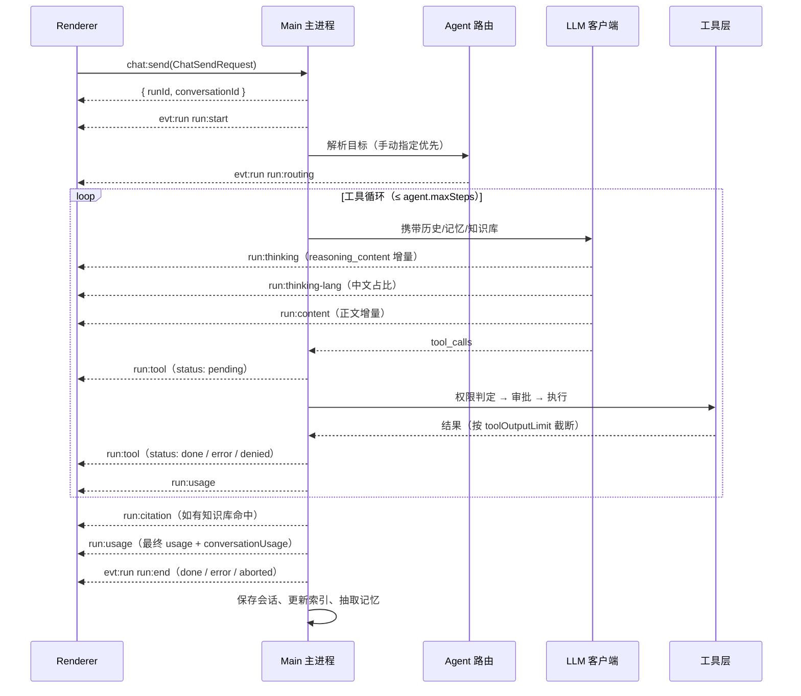

# 架构说明

本文描述 Run worker 的进程模型、IPC 契约、一次对话的完整事件流、存储布局、平台模块职责与安全边界。
所有字段名、通道名以 `src/shared/` 下的契约文件为准；本文与代码冲突时以代码为准。

- 契约来源：`src/shared/types.ts`、`src/shared/ipc.ts`、`src/shared/platform.ts`、`src/shared/agents.ts`、`src/shared/presets.ts`
- 入口：`package.json` 的 `main` 指向 `dist-electron/main/index.js`

---

## 1. 进程模型

| 进程 / 层 | 目录 | 职责 | 能碰什么 |
| --- | --- | --- | --- |
| Main | `src/main/` | 窗口、IPC 服务端、模型调用、工具执行、文件与网络、平台模块 | Node.js 全部能力 |
| Preload | `src/preload/index.ts` | 用 `contextBridge` 暴露白名单 API 到 `window.runworker` | 仅 `ipcRenderer` |
| Renderer | `src/renderer/` | React 界面、消息渲染、设置表单、事件订阅 | 只有 `window.runworker` |

约定：

- 渲染进程运行在 `contextIsolation: true`、`nodeIntegration: false` 下，拿不到 `require` / `process`。
- 主进程 → 渲染进程的推送统一走 `webContents.send`，通道名集中在 `EVT`。
- 渲染进程不做任何“猜测式”调用：没有对应 `RunWorkerApi` 方法的能力，主进程就没有开放。

类型上，`RunWorkerApi`（见 `src/shared/ipc.ts`）就是唯一对外契约：

```ts
window.runworker.bootstrap()            // 一次性拿全量启动数据
window.runworker.chat.send(req)         // 发起一轮运行
window.runworker.events.onRun(cb)       // 订阅流式事件，返回取消函数
```

---

## 2. IPC 通道表

### 2.1 请求 / 响应（`invoke` ↔ `ipcMain.handle`）

| 通道 | API 方法 | 用途 |
| --- | --- | --- |
| `app:bootstrap` | `bootstrap()` | 返回 `BootstrapPayload`：设置、渠道预设、Agent 清单、会话索引、MCP、定时任务、知识库、记忆、更新信息、`AppInfo` |
| `app:info` | `app.info()` | 版本、Electron/Chrome/Node 版本、`userData`、安装目录、环境变量状态、仓库地址 |
| `app:open-external` | `app.openExternal(url)` | 用系统浏览器打开外部链接（仅 http/https 白名单） |
| `app:open-path` | `app.openPath(path)` | 在资源管理器中定位文件或目录 |
| `app:pick-files` | `app.pickFiles(opts)` | 文件选择对话框，返回 `Attachment[]` |
| `app:pick-directory` | `app.pickDirectory()` | 目录选择对话框，返回路径或 `null` |
| `win:minimize` | `window.minimize()` | 最小化窗口（`send`，无需返回） |
| `win:maximize` | `window.maximize()` | 最大化 / 还原 |
| `win:close` | `window.close()` | 关闭窗口 |
| `settings:get` | `settings.get()` | 读取完整 `Settings` |
| `settings:update` | `settings.update(patch)` | 深合并补丁并回写，返回新设置 |
| `settings:reset` | `settings.reset()` | 恢复默认设置（不删对话） |
| `providers:presets` | `settings.presets()` | 返回 6 个内置渠道预设 |
| `providers:test` | `settings.testProvider(cfg)` | 连通性探测，返回 `ProviderTestResult`（含 `latencyMs`、可用模型） |
| `providers:models` | `settings.models(cfg)` | 拉取该渠道的模型列表 |
| `chat:send` | `chat.send(req)` | 发起一轮运行，立即返回 `{ runId, conversationId }`，内容走事件流 |
| `chat:abort` | `chat.abort(runId?)` | 中断当前（或指定）运行 |
| `chat:approve` | `chat.approve(requestId, approved, remember?)` | 回应工具执行审批；`remember` 为真时本轮记住选择 |
| `conv:list` | `conversations.list()` | 会话索引（置顶优先，按 `updatedAt` 倒序） |
| `conv:get` | `conversations.get(id)` | 会话全文 |
| `conv:create` | `conversations.create(title?)` | 新建会话 |
| `conv:rename` | `conversations.rename(id, title)` | 重命名 |
| `conv:remove` | `conversations.remove(id)` | 删除单个会话 |
| `conv:clear` | `conversations.clear()` | 清空全部会话 |
| `conv:pin` | `conversations.pin(id, pinned)` | 置顶 / 取消置顶 |
| `conv:export` | `conversations.exportMarkdown(id)` | 导出 Markdown 文本（思考过程折叠为 `<details>`） |
| `agents:list` | `agents.list()` | 返回 8 个 `AgentDescriptor` |
| `mcp:list` | `mcp.list()` | MCP 服务器状态列表 |
| `mcp:tools` | `mcp.tools()` | 所有已连接服务器暴露的工具 |
| `mcp:add` | `mcp.add(cfg)` | 新增服务器配置 |
| `mcp:remove` | `mcp.remove(id)` | 删除服务器配置 |
| `mcp:toggle` | `mcp.toggle(id, enabled)` | 启用 / 停用 |
| `mcp:connect` | `mcp.connect(id)` | 建立连接并握手 |
| `mcp:call` | `mcp.call(serverId, tool, args)` | 直接调用某个 MCP 工具 |
| `task:list` | `tasks.list()` | 定时任务列表 |
| `task:save` | `tasks.save(task)` | 新增或更新任务 |
| `task:remove` | `tasks.remove(id)` | 删除任务 |
| `task:run` | `tasks.run(id)` | 立即执行一次，返回 `TaskRun` |
| `task:history` | `tasks.history()` | 历史执行记录 |
| `kb:list` | `knowledge.list()` | 知识源列表 |
| `kb:add-source` | `knowledge.addSource(path, watch?)` | 添加目录/文件并开始索引 |
| `kb:remove` | `knowledge.remove(id)` | 移除知识源 |
| `kb:reindex` | `knowledge.reindex(id?)` | 重建索引（省略 id 为全量） |
| `kb:search` | `knowledge.search(query, topK?)` | 检索，返回带 `score` 的 `KnowledgeHit[]` |
| `kb:stats` | `knowledge.stats()` | 源/文档/分块数量与 `vectorReady` |
| `memory:list` | `memory.list()` | 记忆条目 |
| `memory:add` | `memory.add(fact)` | 手动新增一条记忆 |
| `memory:forget` | `memory.forget(id)` | 删除单条 |
| `memory:clear` | `memory.clear()` | 清空全部记忆 |
| `update:check` | `update.check(force?)` | 检查更新，返回 `UpdateInfo` |
| `update:open` | `update.open()` | 打开下载页 |

### 2.2 主进程主动推送（`webContents.send` ↔ `ipcRenderer.on`）

| 通道 | API 订阅 | 载荷 | 触发时机 |
| --- | --- | --- | --- |
| `evt:run` | `events.onRun` | `RunEvent` | 运行全过程的流式事件 |
| `evt:approval` | `events.onApproval` | `ApprovalRequest` | 需要用户确认工具执行 |
| `evt:toast` | `events.onToast` | `ToastPayload` | 轻提示（成功/警告/错误） |
| `evt:tasks-changed` | `events.onTasksChanged` | `ScheduledTask[]` | 任务增删改、执行后刷新 `nextRunAt` |
| `evt:mcp-changed` | `events.onMcpChanged` | `McpServerStatus[]` | 连接状态变化 |
| `evt:kb-changed` | `events.onKnowledgeChanged` | `KnowledgeSource[]` | 索引进度变化 |
| `evt:update-available` | `events.onUpdateAvailable` | `UpdateInfo` | 后台检查发现新版本 |
| `evt:settings-changed` | `events.onSettingsChanged` | `Settings` | 设置被主进程或其他窗口修改 |
| `evt:system-theme` | `events.onSystemTheme` | `'dark' \| 'light'` | 系统主题切换（`theme: 'system'` 时生效） |

订阅函数均返回取消函数：

```ts
const off = window.runworker.events.onRun((e) => { /* ... */ });
off(); // 组件卸载时务必调用
```

---

## 3. 一次对话的完整事件流



`RunEvent` 的完整判别联合（`src/shared/types.ts`）：

| `type` | 关键字段 | 说明 |
| --- | --- | --- |
| `run:start` | `runId`、`conversationId`、`agentId`、`model` | 开始，界面切到“运行中”。`agentId` 是本轮**入口 Agent**（未路由时即执行者）；若随后发生路由，最终执行者以 `run:routing.to` 与 `assistant.agentId` 为准 |
| `run:routing` | `from`、`to`、`reason` | 总调度把任务交给子 Agent。`from` / `to` 是稳定契约；`reason` 仅供展示，措辞不保证稳定，不能用作判断依据 |
| `run:thinking` | `delta` | 思考流增量 |
| `run:thinking-lang` | `ratio`、`rewritten` | 中文占比低于 `chineseRatioThreshold` 时触发重述 |
| `run:content` | `delta` | 正文流增量 |
| `run:tool` | `call: ToolCallRecord` | 工具状态变更，同一 `id` 多次推送表示状态迁移 |
| `run:citation` | `citations: Citation[]` | 知识库引用 |
| `run:usage` | `usage`、`conversationUsage` | 单轮与会话累计用量 |
| `run:end` | `status`、`messageId`、`error` | 结束；`aborted` 表示用户中断 |
| `run:notice` | `level`、`text` | 非致命提示，如「已达到最大步数，工具循环停止」「历史已压缩」「未配置图像渠道」 |

`ToolCallRecord.status` 迁移：`pending` → `approved` / `denied` → `running` → `done` / `error`。

路由只决定**本轮执行者**：`run:routing` 在基线为总调度且发生切换时出现；`conversation.agentId` 是用户为会话选定的基线，**只在手动指定子 Agent 时写入，自动路由不回写**，因此同一会话每轮都可重新分派。手动选择时跳过路由，只写一条 `conversation.trace`（`action: '手动指定'`）；自动路由的 trace 为 `action: '自动路由'`（`detail: 'orchestrator → code：<reason>'`），未切换时为 `action: '路由判定'`。

---

## 4. 存储布局

单机纯文件，无数据库。根目录为 `app.getPath('userData')`，即 `%APPDATA%/Run worker/`。

```text
%APPDATA%/Run worker/
├─ settings.json                  # 唯一配置文件：Settings 全量（含 mcpServers，无独立配置文件）
├─ conversations/
│  ├─ index.json                  # ConversationMeta[]
│  └─ conv_<ts><rand>.json        # Conversation 全文
├─ kb/
│  └─ index.json                  # 知识源 + 分块 + 倒排词频
├─ memory/
│  └─ facts.json                  # MemoryFact[]
├─ tasks/
│  ├─ tasks.json                  # ScheduledTask[]
│  └─ history.json                # TaskRun[]，上限 100 条
├─ task-output/                   # indexResult=true 且执行成功的任务输出 <taskId>-<ISO时间戳>.md（按需创建）
├─ update/
│  └─ cache.json                  # 更新检测缓存
├─ logs/
│  └─ main-YYYY-MM-DD.log         # 按天切分，不含 API Key
├─ workspace/                     # Agent 默认工作目录
└─ artifacts/                     # 生成物（图片/图表/视频/3D）
```

同级的 `Cache/`、`Code Cache/`、`GPUCache/`、`Local Storage/`、`Network/`、`Preferences`、`Local State`、`blob_storage/`、`Session Storage/`、`tmp/` 由 Chromium 写入，**不是应用数据**，删除只影响登录态与窗口状态，不影响对话、设置、知识库。

实现要点（`src/main/store.ts`）：

- **原子写**：先写 `*.tmp` 再 `rename`；Windows 下目标被占用导致 `rename` 失败时退化为覆盖写。
- **损坏容错**：JSON 解析失败时把原文件重命名为 `*.corrupt-<ts>` 并回落默认值，不阻塞启动。
- **设置迁移**：`migrateSettings` 做深合并 + 区间裁剪，越界值回落默认；`activeProviderId` / `activeModel` 失效时自动修正。
- **索引自愈**：`index.json` 缺失或非法时扫描 `conversations/*.json` 重建。
- **子目录归属**：`conversations/`、`logs/`、`workspace/`、`artifacts/` 由 `store.ts` 建；`kb/`、`memory/`、`tasks/`、`update/` 由对应平台模块在首次使用时创建。`task-output/` 不是固定目录——只有勾选 `indexResult` 的任务成功执行后才出现，文件名为 `<taskId>-<ISO时间戳去冒号>.md`，含任务名、任务 ID、执行时间与输出正文。
- 会话正文有内存缓存，`getConversation` 优先命中缓存；`deleteConversation` 同步清缓存。

---

## 5. 平台模块职责

接口定义在 `src/shared/platform.ts`，实现位于 `src/main/platform/`。全部通过 `PlatformDeps` 注入依赖，便于替换与单测。

| 模块 | 文件 | 接口 | 职责 |
| --- | --- | --- | --- |
| MCP 管理器 | `mcp.ts` | `McpManager` | 按 `transport`（`stdio` / `http`）启动与握手、收集 `McpToolInfo`、转发 `call`；`init()` 只自动连接 `enabled && autoStart` 的服务器，单个失败只把自己置 `error`，不影响其他服务器 |
| 定时任务 | `scheduler.ts` | `TaskScheduler` | 解析 `cron`（5 段）/ `interval` / `once`，到点通过 `AgentRunner.run` 执行，记录 `TaskRun`（上限 100 条），`indexResult` 为真时把输出写入 `task-output/` |
| 本地知识库 | `knowledge.ts` | `KnowledgeBase` | 目录遍历、分块、BM25 词法检索（`vectorReady` 恒为 `false`）；检索结果类型是 `KnowledgeHit`，注入提示词时由 chat 层转成 `Citation`（`path` → `sourcePath`） |
| 长期记忆 | `memory.ts` | `MemoryStore` | 四类记忆（`preference` / `fact` / `project` / `instruction`）、`recall` 召回（含时间衰减）、`digest` 生成注入摘要 |
| 更新检测 | `updater.ts` | `Updater` | 读 `update.feed`（为空则从 `repoUrl` 解析 `owner/repo`），比对 GitHub Release 与本地版本，15s 超时；`downloadUrl` 优先取 Release 中 `.exe`/`.msi` 资产，没有则回退 `html_url`；`notes` 截断 8000 字 |
| 安全策略 | `permissions.ts` | `PermissionGuard` | `inspectCommand` / `inspectFileWrite` 返回 `CommandVerdict`（`allowed`、`requiresApproval`、`risk`） |

`PlatformDeps` 提供 `dataDir`、`settings()`、`saveSettings()`、`emit()`、`log`；`emit` 即上文 `EVT` 通道的发送入口。

### 5.1 更新检测的错误分档

`updater.check()` 不抛异常，任何失败都写进 `UpdateInfo.error` 并保持 `available: false`，界面直接展示这段中文文案。

| 场景 | `error` 文案 |
| --- | --- |
| 仓库不存在 / 无权访问（404） | 更新源仓库不存在或无权访问（HTTP 404），请检查设置中的更新源 |
| 需要授权（401） | 更新源需要授权（HTTP 401），请确认仓库是否私有 |
| 限流（403 且 `x-ratelimit-remaining: 0`） | GitHub 接口调用次数已超限（HTTP 403），约 HH:mm:ss 后恢复 |
| 403 非限流 | 无权访问更新源（HTTP 403），请检查仓库可见性 |
| 频率过高（429） | 请求过于频繁（HTTP 429），请稍后重试 |
| 服务端故障（5xx） | 更新服务暂时不可用（HTTP 500），请稍后再试 |
| 其它状态码 | GitHub 更新接口返回 HTTP n，请稍后再试（自定义 feed 时前缀为「更新源返回」） |
| 网络异常 | 网络请求失败：<底层错误> |
| 15s 超时 | 检查更新超时，请检查网络后重试 |
| 返回体不是 JSON | 更新源返回的内容不是合法 JSON |
| 未配置更新源 | 未配置更新源（请在设置中填写 owner/repo） |
| 仓库存在但无 Release | 更新源暂无发布版本（非错误） |
| 只有 prerelease 而 `channel = stable` | 暂无正式版本可用（非错误） |

`AgentRunner` 是平台模块反向调用主 Agent 的唯一入口：

```ts
run(prompt: string, opts?: { agentId?; title?; source? }): Promise<{ text: string; conversationId: string }>
```

定时任务与未来的工作流都走它，避免平台层直接依赖 `chat/service`。

---

## 6. 安全边界

| 边界 | 做法 |
| --- | --- |
| 进程隔离 | `contextIsolation: true`、`nodeIntegration: false`、`sandbox` 保持默认；渲染进程只能调 `window.runworker` |
| API 白名单 | `preload` 只映射 `IPC` / `EVT` 常量，不接受任意通道字符串；无 `ipcRenderer.send(channel)` 透传 |
| 外部链接 | 已实现：`app:open-external` 只放行 `^https?://`，其余协议直接抛「只允许打开 http/https 链接。」；`index.ts` 中对窗口内 `window.open` 与新窗口请求同样只放行 http(s) |
| 命令执行 | `PermissionGuard` 双层判定：`agent.denyPatterns` 黑名单直接拒绝；正则风险模式（`rm -rf`、`format`、`diskpart`、`shutdown`、注册表删除等）要求审批 |
| 审批模式 | `approvalMode`：`always` 每条都问 / `safe-only` 仅高风险问（默认）/ `never` 全放行 |
| 执行约束 | 命令在 `agent.workspaceDir` 下执行，受 `agent.commandTimeout`（默认 120000ms）限制，单轮步数受 `agent.maxSteps`（默认 12）限制 |
| 密钥 | API Key 只存在 `settings.json`，不回传渲染进程、不拼进 URL query；日志经 `createLogger` 的 `redactSecrets` 统一脱敏后才落盘 |
| 数据外发 | 仅两类：发给你配置的模型接口、以及 Agent 显式调用 `net.fetch`；`telemetry` 默认 `false` |
| 安装器权限 | NSIS `requestedExecutionLevel: asInvoker`，只写 `HKCU`，不要求管理员 |

风险提示：`approvalMode: 'never'` 与自定义 `denyPatterns` 清空都会显著扩大攻击面，仅在隔离环境中使用。详见 [SECURITY.md](../SECURITY.md)。
